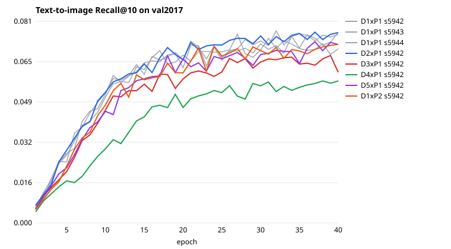
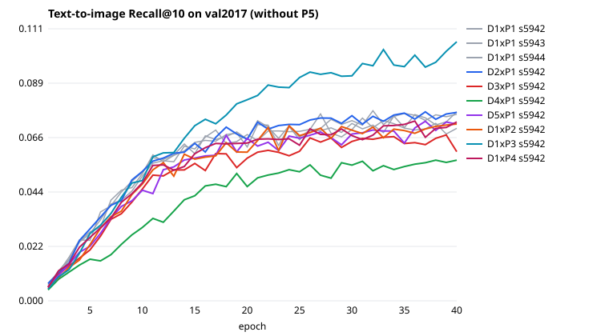
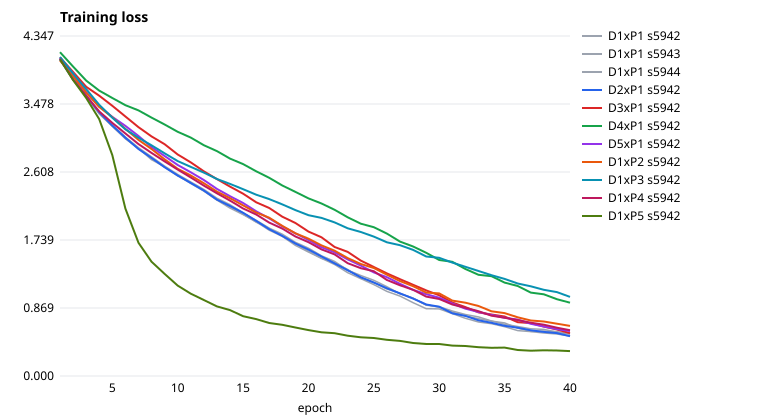

# Round 1 results (Alpine, 2026-11-27)

All eleven first-round runs: D1–D5 × P1 (D1 with model seeds 5942–5944) and D1 × P2–P5. Every run:
40 epochs, 640 × 640, batch 64, AMP, on an A100 PCIe 40 GB (0.78–0.81 s/step; P2 1.04 s/step),
evaluated on all of val2017 (5,000 images, 25,000 captions) after every epoch.

The per-epoch metrics and run configs are in `results/round1/<run>/`. The tables below are generated
by `python3 scripts/analyze_runs.py --runs results/round1`. Checkpoints (`final.pt`, 499 MB each)
are not in Git; they are on Alpine in `/scratch/alpine/bihs8849/mega/artifacts/runs/`, backed up to
`/projects/bihs8849/mega-results/`.

## Findings

- **P5 (RGB + CLIP features) is far ahead: t2i R@10 0.411, 5.5× the baseline mean (0.074).** The
  diagnostics show the model depends on the CLIP vector: with it zeroed, R@10 drops to 0.017; with
  it shuffled across images, to 0.006. Both are below the RGB-only baseline, so the pixel branch
  learned little once CLIP was available. This is not a like-for-like preprocessing comparison:
  the frozen CLIP encoder brings knowledge from web-scale pretraining (DataComp-XL, 13B samples
  seen) that no other arm has, and we cannot rule out overlap between that data and COCO images.
- **P3 (random resized crop) is the best pixel-only arm: R@10 0.105, +42% over the baseline mean**,
  about 9 baseline standard deviations above it, and above it on every metric. It is the only run
  whose val R@10 is still rising at epoch 40; its training loss ends at 1.01 against about 0.53
  for the baseline. The augmentation reduces the overfitting seen in every other run.
- **D3 and D4 score below random selection.** Both fall under the lowest D1 × P1 seed, at the final
  epoch and on the last-5-epoch mean. D4 is lowest from about epoch 5 onward and also fits its own
  training set worse (final training loss 0.94).
- **D2, D5, P2 and P4 are indistinguishable from the baseline** on t2i R@10. P4 does not improve
  color-word retrieval either: its color R@10 (0.102) is inside the baseline range (0.095–0.114).
  D2's RSUM is slightly above the best seed, which one seed cannot confirm.
- **Every P1 run overfits after about epoch 20.** Training loss keeps falling to about 0.5 while val
  R@10 flattens near 0.07. This may compress the differences between selections.

Every arm except D1 × P1 has one seed, so these are preliminary. Single epochs are noisy as well:
D3 moved from 0.0674 to 0.0606 between epochs 39 and 40.

Final epoch is the headline; the last-5-epoch mean is a robustness check. The baseline
spread comes from the D1xP1 seeds (weight initialization only). "Inside" means within
the seeds' min-max range. Three seeds give a descriptive range, not a significance test.

## Final epoch

| Arm | Seed | t2i@1 | t2i@5 | t2i@10 | i2t@1 | i2t@5 | i2t@10 | rsum | t2i@10_color | train_loss |
|---|---:|---:|---:|---:|---:|---:|---:|---:|---:|---:|
| D1xP1 | 5942 | 0.0099 | 0.0393 | 0.0702 | 0.0062 | 0.0330 | 0.0590 | 0.2176 | 0.0949 | 0.5357 |
| D1xP1 | 5943 | 0.0101 | 0.0434 | 0.0768 | 0.0098 | 0.0398 | 0.0698 | 0.2497 | 0.1140 | 0.5373 |
| D1xP1 | 5944 | 0.0112 | 0.0442 | 0.0758 | 0.0108 | 0.0404 | 0.0708 | 0.2533 | 0.1003 | 0.5098 |
| D2xP1 | 5942 | 0.0118 | 0.0450 | 0.0766 | 0.0086 | 0.0448 | 0.0718 | 0.2587 | 0.1006 | 0.5095 |
| D3xP1 | 5942 | 0.0094 | 0.0359 | 0.0606 | 0.0074 | 0.0324 | 0.0540 | 0.1998 | 0.0848 | 0.5472 |
| D4xP1 | 5942 | 0.0069 | 0.0313 | 0.0572 | 0.0064 | 0.0248 | 0.0466 | 0.1732 | 0.0648 | 0.9375 |
| D5xP1 | 5942 | 0.0095 | 0.0408 | 0.0718 | 0.0110 | 0.0394 | 0.0650 | 0.2376 | 0.0999 | 0.5743 |
| D1xP2 | 5942 | 0.0102 | 0.0402 | 0.0719 | 0.0072 | 0.0390 | 0.0644 | 0.2330 | 0.0928 | 0.6401 |
| D1xP3 | 5942 | 0.0155 | 0.0620 | 0.1054 | 0.0168 | 0.0640 | 0.1050 | 0.3686 | 0.1576 | 1.0118 |
| D1xP4 | 5942 | 0.0111 | 0.0411 | 0.0728 | 0.0070 | 0.0402 | 0.0668 | 0.2389 | 0.1015 | 0.5860 |
| D1xP5 | 5942 | 0.0940 | 0.2836 | 0.4114 | 0.1180 | 0.3278 | 0.4616 | 1.6964 | 0.4939 | 0.3181 |

## Mean of the last 5 epochs

| Arm | Seed | t2i@1 | t2i@5 | t2i@10 | i2t@1 | i2t@5 | i2t@10 | rsum | t2i@10_color | train_loss |
|---|---:|---:|---:|---:|---:|---:|---:|---:|---:|---:|
| D1xP1 | 5942 | 0.0097 | 0.0400 | 0.0699 | 0.0072 | 0.0342 | 0.0600 | 0.2211 | 0.0955 | 0.5857 |
| D1xP1 | 5943 | 0.0103 | 0.0414 | 0.0743 | 0.0094 | 0.0387 | 0.0677 | 0.2418 | 0.1085 | 0.5722 |
| D1xP1 | 5944 | 0.0106 | 0.0430 | 0.0750 | 0.0107 | 0.0396 | 0.0688 | 0.2478 | 0.0975 | 0.5491 |
| D2xP1 | 5942 | 0.0113 | 0.0437 | 0.0754 | 0.0102 | 0.0416 | 0.0704 | 0.2526 | 0.0994 | 0.5647 |
| D3xP1 | 5942 | 0.0088 | 0.0364 | 0.0644 | 0.0080 | 0.0334 | 0.0568 | 0.2078 | 0.0933 | 0.6273 |
| D4xP1 | 5942 | 0.0074 | 0.0315 | 0.0565 | 0.0066 | 0.0257 | 0.0463 | 0.1740 | 0.0661 | 1.0362 |
| D5xP1 | 5942 | 0.0095 | 0.0402 | 0.0714 | 0.0093 | 0.0362 | 0.0633 | 0.2298 | 0.1008 | 0.6391 |
| D1xP2 | 5942 | 0.0097 | 0.0395 | 0.0705 | 0.0086 | 0.0376 | 0.0650 | 0.2309 | 0.0952 | 0.6932 |
| D1xP3 | 5942 | 0.0145 | 0.0575 | 0.0998 | 0.0161 | 0.0594 | 0.0991 | 0.3465 | 0.1509 | 1.1032 |
| D1xP4 | 5942 | 0.0096 | 0.0401 | 0.0706 | 0.0097 | 0.0403 | 0.0662 | 0.2366 | 0.0980 | 0.6511 |
| D1xP5 | 5942 | 0.0947 | 0.2783 | 0.4052 | 0.1160 | 0.3189 | 0.4504 | 1.6636 | 0.4834 | 0.3257 |

## Compared with D1xP1 (final epoch)

D1xP1 t2i_recall@10: mean 0.0743, sd 0.0036, range 0.0702-0.0768 over 3 seeds. RSUM: mean 0.2402, range 0.2176-0.2533.

| Arm | Seed | t2i@10 | Δ vs D1xP1 | Inside | RSUM | Δ RSUM | Inside |
|---|---:|---:|---:|:-:|---:|---:|:-:|
| D1xP5 | 5942 | 0.4114 | +0.3372 | **no** | 1.6964 | +1.4563 | **no** |
| D1xP3 | 5942 | 0.1054 | +0.0311 | **no** | 0.3686 | +0.1285 | **no** |
| D2xP1 | 5942 | 0.0766 | +0.0024 | yes | 0.2587 | +0.0185 | **no** |
| D1xP4 | 5942 | 0.0728 | -0.0015 | yes | 0.2389 | -0.0013 | yes |
| D1xP2 | 5942 | 0.0719 | -0.0024 | yes | 0.2330 | -0.0072 | yes |
| D5xP1 | 5942 | 0.0718 | -0.0024 | yes | 0.2376 | -0.0026 | yes |
| D3xP1 | 5942 | 0.0606 | -0.0136 | **no** | 0.1998 | -0.0404 | **no** |
| D4xP1 | 5942 | 0.0572 | -0.0171 | **no** | 0.1732 | -0.0670 | **no** |

## Compared with D1xP1 (last-5 mean)

D1xP1 t2i_recall@10: mean 0.0731, sd 0.0028, range 0.0699-0.0750 over 3 seeds. RSUM: mean 0.2369, range 0.2211-0.2478.

| Arm | Seed | t2i@10 | Δ vs D1xP1 | Inside | RSUM | Δ RSUM | Inside |
|---|---:|---:|---:|:-:|---:|---:|:-:|
| D1xP5 | 5942 | 0.4052 | +0.3322 | **no** | 1.6636 | +1.4267 | **no** |
| D1xP3 | 5942 | 0.0998 | +0.0267 | **no** | 0.3465 | +0.1096 | **no** |
| D2xP1 | 5942 | 0.0754 | +0.0024 | **no** | 0.2526 | +0.0157 | **no** |
| D5xP1 | 5942 | 0.0714 | -0.0016 | yes | 0.2298 | -0.0071 | yes |
| D1xP4 | 5942 | 0.0706 | -0.0025 | yes | 0.2366 | -0.0003 | yes |
| D1xP2 | 5942 | 0.0705 | -0.0026 | yes | 0.2309 | -0.0060 | yes |
| D3xP1 | 5942 | 0.0644 | -0.0087 | **no** | 0.2078 | -0.0291 | **no** |
| D4xP1 | 5942 | 0.0565 | -0.0166 | **no** | 0.1740 | -0.0629 | **no** |

## P5 diagnostics (final epoch)

If the model uses the CLIP vector, zeroing or shuffling it should lower recall.

| Run | Eval input | t2i@10 | RSUM |
|---|---|---:|---:|
| D1xP5 s5942 | real CLIP | 0.4114 | 1.6964 |
| | zeroed_clip | 0.0170 | 0.0488 |
| | shuffled_clip | 0.0058 | 0.0174 |
